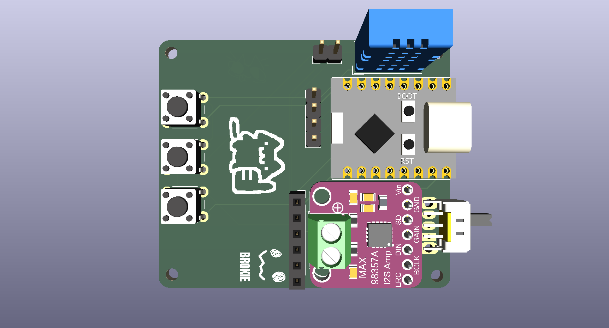
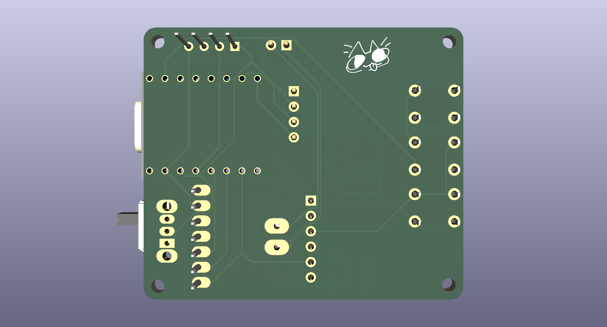

# Desk_buddy
A desk companion that you can place on your desk, which displays the time, starts timers, and provides room temperature and weather forecasts through voice commands.

## Description
So I made this because i saw multiple people on youtube making their own desk buddy 

So I also wanted to make one that can tell time set timers,show weather,Check room temprature and humidity 
I also wanted it to act as a chat Bot and added microphone and Speaker into the PCB design But because of my limited knowledge I couldn't add chat bot feature but I will be adding them soon 
The PCb has Both the microphone and speaker ports in it so if u want to add the chat bot u can add it by writing your own firmware  

### Screenshots
- *PCB*
 
  
  

- *Case*

     
     
    

-*Explode View* 

   

- *Schematic*
 
  **[Schematics.pdf](Render/Schematics.pdf)**  

## BOM

Full parts list with quantities and costs: **[BOM.csv](BOM.csv)**
        
## Getting Started

- First of all download the Gerber files from production Folder
- ORder your PCb using those Gerber files
- U can also add changes to Pcb by downloading KIcad files From PCB folder
- After that solder your parts onto the pcb and connect your Oled screen with jumper wires
  
### Dependencies

- *Arduino IDE *
- *ESP board instalation in Arduino IDE*
- *USB Cable*

### Installing
- Download the **[Firmware.ino](Firmware.ino)**
- Open it in Arduino IDE

### Executing program
-*Connect your ESP board with pc using a USB cable *
-*Select your ESP as the board in Arduino IDE*
-*Click the Upload(arrow) button to flash your Esp board with firmware*

## License

This project is licensed under the [MIT License](LICENSE).
