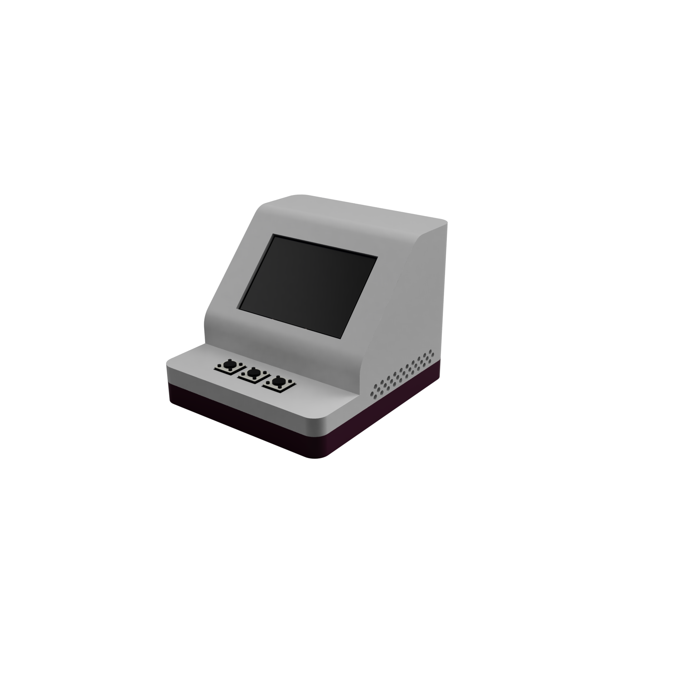
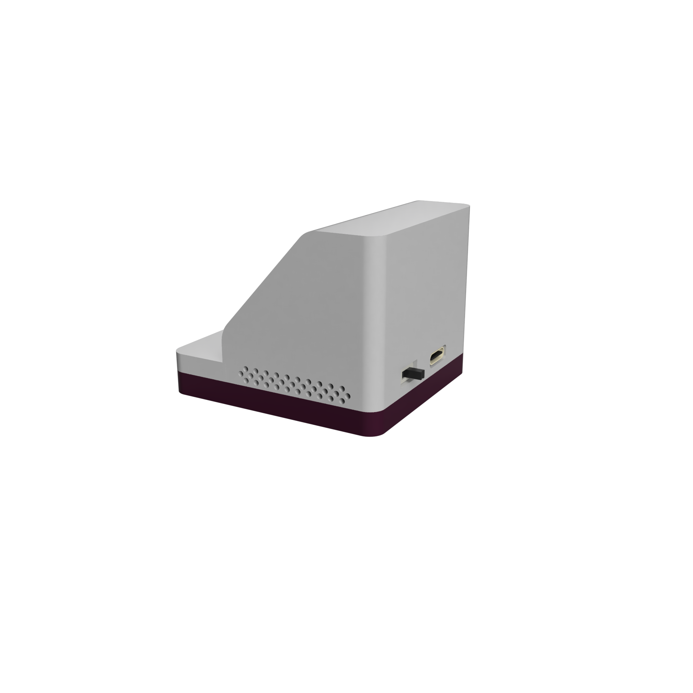
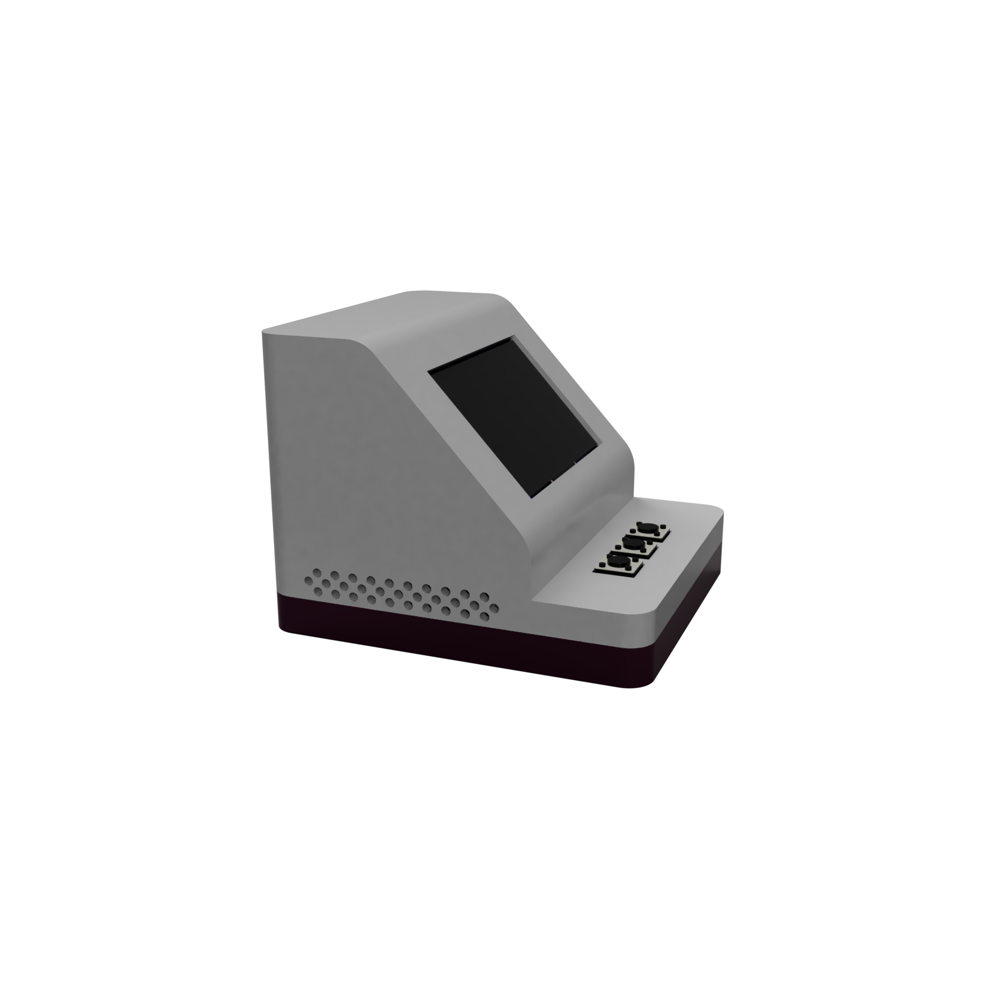
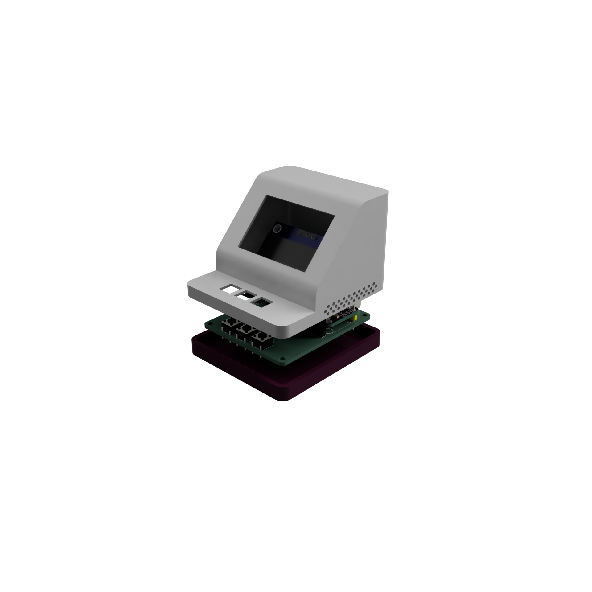

# Desk_buddy
A desk companion that you can place on your desk, which displays the time, starts timers, and provides room temperature and weather forecasts through voice commands.


## Description

An in-depth paragraph about your project and overview of use.

### Screenshots
Atleast one relavant screenshot of the program
- *PCB*
  
  

- *Case*

     
     
    
    
    

- *Schematic*

    <embed src="Render/Schematics.pdf" type="application/pdf" width="600" height="500">
 
## Getting Started

### Dependencies

* Describe any prerequisites, libraries, OS version, etc., needed before installing program.
* ex. Windows 10

### Installing

* How/where to download your program
* Any modifications needed to be made to files/folders

### Executing program

* How to run the program
* Step-by-step bullets
```
code blocks for commands
```

## Help

Any advise for common problems or issues.
```
command to run if program contains helper info
```

## License

This project is licensed under the [NAME HERE] License - see the LICENSE.md file for details
